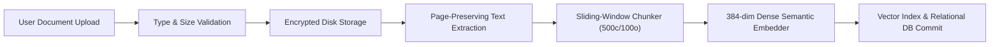
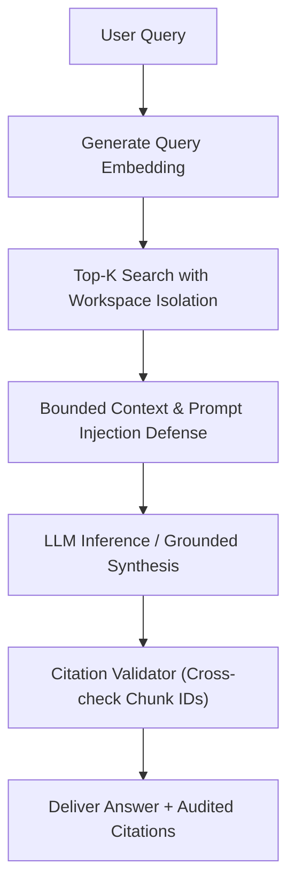
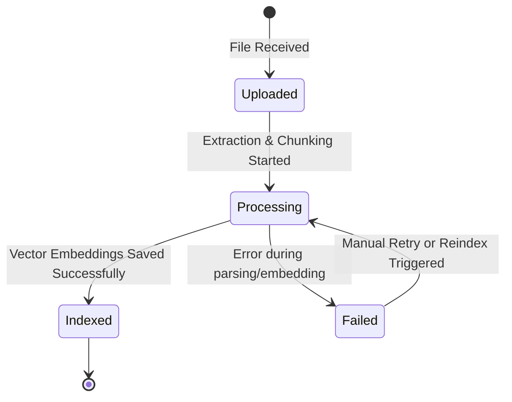

# KnowFlow AI System Architecture

## 1. High-Level System Architecture

KnowFlow AI is architected as an asynchronous, decoupled document intelligence and retrieval-augmented generation (RAG) platform.

```mermaid
flowchart TD
    Client["React 18 SPA (Vite + TS + Tailwind)"]
    API["FastAPI ASGI Gateway (/api/v1)"]
    DB[("Relational DB (SQLAlchemy / SQLite)")]
    VS[("Vector Index (Normalized Cosine Similarity)")]
    FS["File System (/uploads/<workspace_id>)"]
    LLM["Configured LLM / Grounded Demo Synthesizer"]

    Client -->|REST & Multipart HTTP| API
    API -->|Metadata, Workspaces, Chats| DB
    API -->|Dense Vectors & Filtering| VS
    API -->|Original Documents (PDF/TXT/MD)| FS
    API -->|Bounded Prompt Context| LLM
```

## 2. Ingestion Flow Pipeline



## 3. Query-Time Grounded RAG Pipeline



## 4. Job Lifecycle State Machine



## 5. Security & Isolation Model

- **Tenant Isolation:** Every vector search and database lookup incorporates an obligatory `workspace_id` filter condition, eliminating data cross-contamination.
- **Untrusted Context Containment:** Ingested document passages are wrapped inside strict `<retrieved_documents>` delimiters and treated purely as passive text data to prevent indirect prompt injection.
- **Citation Auditing:** Prevents hallucinated sources by matching cited IDs against actual retrieved passages.
